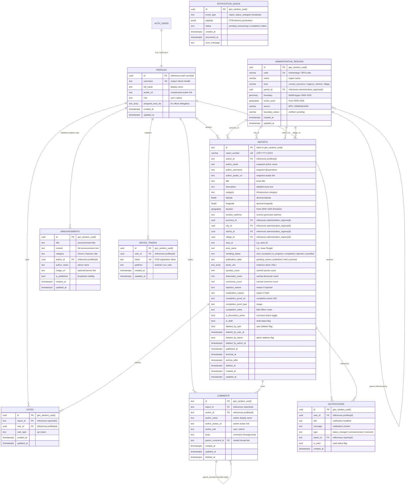

# Laporin — Entity Relationship Diagram (ERD)

Dokumen ini memvisualisasikan arsitektur relasional database **Laporin** menggunakan diagram Mermaid resmi beserta kardinalitas dan relasi foreign key.

---

## 1. Diagram Relasi Entitas

---

## 2. Ringkasan Kardinalitas & Referential Integrity

| Relasi | Tipe Kardinalitas | Aturan Hapus (ON DELETE) | Penjelasan Integritas |
| :--- | :---: | :---: | :--- |
| `auth.users` $\rightarrow$ `profiles` | 1 to 1 | `CASCADE` | Profil akun terhapus bersih saat akun user dihapus dari auth. |
| `administrative_regions` $\rightarrow$ `administrative_regions` | 1 to Many | `RESTRICT` | Wilayah induk tidak dapat dihapus jika masih membawahi wilayah turunan. |
| `administrative_regions` $\rightarrow$ `reports` | 1 to Many | `SET NULL` | Laporan tetap utuh bila kode wilayah direstrukturisasi/dimekarkan. |
| `profiles` $\rightarrow$ `reports` | 1 to Many | `CASCADE` | Laporan terikat langsung dengan profil pembuat. |
| `reports` $\rightarrow$ `votes` | 1 to Many | `CASCADE` | Seluruh vote laporan terhapus saat laporan dihapus permanen. |
| `profiles` $\rightarrow$ `votes` | 1 to Many | `CASCADE` | Vote terhapus bila profil pemilik vote dihapus. |
| `reports` $\rightarrow$ `comments` | 1 to Many | `CASCADE` | Seluruh komentar terhapus bila laporan dihapus permanen. |
| `comments` $\rightarrow$ `comments` | 1 to Many | `CASCADE` | Balasan komentar bertingkat terhapus bila komentar induk dihapus. |
| `profiles` $\rightarrow$ `announcements`| 1 to Many | `CASCADE` | Pengumuman terikat pada admin pembuat. |
| `profiles` $\rightarrow$ `device_tokens` | 1 to Many | `CASCADE` | Token FCM perangkat terhapus saat akun pengguna dihapus. |
| `profiles` $\rightarrow$ `notifications` | 1 to Many | `CASCADE` | Inbox notifikasi terhapus saat akun pengguna dihapus. |
| `reports` $\rightarrow$ `notifications` | 1 to Many | `CASCADE` | Notifikasi terkait laporan terhapus bila laporan terhapus permanen. |

