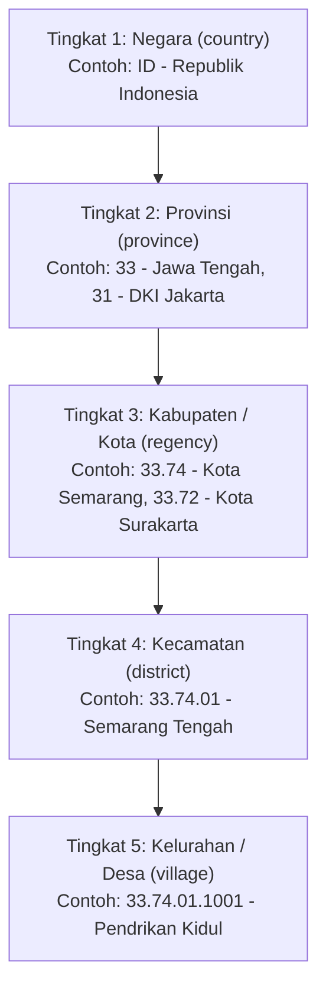

# Laporin — PostGIS & Geospatial Architecture Specification

Dokumen ini menjelaskan perancangan arsitektur geospasial **Laporin** berbasis **PostGIS** untuk mendukung validasi lokasi, kueri radius terdekat, dan ekspansi skala nasional ke seluruh 38 provinsi di Indonesia.

---

## 1. Arsitektur Spasial: Geometry vs Geography

Dalam sistem database Laporin, diterapkan pemisahan fungsi spasial yang presisi antara tipe data `GEOGRAPHY` dan `GEOMETRY`:

```
┌────────────────────────────────────────────────────────────────────────┐
│                        TIPE DATA POSTGIS LAPORIN                       │
├───────────────────────────────────┬────────────────────────────────────┤
│ 1. GEOGRAPHY(Point, 4326)         │ 2. GEOMETRY(MultiPolygon, 4326)    │
│    Kolom: reports.location        │    Kolom: admin_regions.boundary   │
│    Kebutuhan: Jarak sferis nyata  │    Kebutuhan: Operasi topologi,    │
│    (meter/km), kueri radius       │    point-in-polygon, ST_Covers,    │
│    ST_DWithin tanpa proyeksi      │    ST_Contains dengan kecepatan    │
│    manual planar.                 │    tinggi pada bidang kartesian.   │
└───────────────────────────────────┴────────────────────────────────────┘
```

* **Sistem Referensi Koordinat (SRID):** `4326` (WGS 84 standar GPS global).
* **Urutan Koordinat Standar:** Longitude (X), Latitude (Y) sesuai standar internasional OGC & PostGIS.

---

## 2. Hierarki Wilayah Administratif Indonesia

Tabel `public.administrative_regions` menggunakan struktur *self-referencing parent-child hierarchy* untuk memodelkan 5 tingkat administratif resmi Republik Indonesia:



### Status Data Awal (Seed Data Aktif):
1. **Negara:** 1 entitas (`ID` — Republik Indonesia).
2. **Provinsi:** Seluruh 38 provinsi Indonesia terdaftar lengkap dengan kode resmi Kemendagri (`11` s/d `96`).
3. **Kabupaten / Kota Jawa Tengah:** 35 kabupaten dan kota di Provinsi Jawa Tengah telah terdaftar dengan kode wilayah dan koordinat titik pusat (`center_point`).
4. **Poligon Batas Jawa Tengah:** Poligon batas resmi daratan Jawa Tengah, Nusakambangan, dan Karimunjawa diinjeksi pada kolom `boundary` provinsi `33`.

---

## 3. Indeks Spasial GiST

Untuk memastikan performa kueri spasial tetap cepat di skala jutaan laporan, diterapkan indeks GiST (*Generalized Search Tree*):

```sql
-- Indeks pada lokasi titik laporan warga
CREATE INDEX idx_reports_spatial_location 
ON public.reports USING GIST(location);

-- Indeks pada poligon batas wilayah administratif
CREATE INDEX idx_admin_regions_boundary 
ON public.administrative_regions USING GIST(boundary);

-- Indeks pada titik pusat wilayah administratif
CREATE INDEX idx_admin_regions_center 
ON public.administrative_regions USING GIST(center_point);
```

Keuntungan indeks GiST:
* Mempercepat kueri pencarian laporan terdekat (`ST_DWithin` dan `<->` KNN operator) dari $O(N)$ menjadi $O(\log N)$.
* Mempercepat deteksi wilayah laporan saat pembuatan (*point-in-polygon*) tanpa membaca seluruh baris tabel poligon.

---

## 4. Fungsi Geospasial (Spatial RPCs)

### 4.1 `validate_report_location(p_lat float8, p_lng float8)`
Memvalidasi apakah suatu titik koordinat berada di dalam cakupan batas wilayah administratif yang terverifikasi di database.
* **Output:** JSONB berisi status `is_valid`, `region_id`, `region_code`, `region_name`, dan `region_level`.

### 4.2 `resolve_report_region(p_lat float8, p_lng float8)`
Mendeteksi secara otomatis hierarki wilayah administratif dari koordinat GPS:
1. Menemukan provinsi yang melingkupi titik via `ST_Covers(boundary, point)`.
2. Menemukan kota/kabupaten yang melingkupi titik, atau memilih kota/kabupaten terdekat berdasarkan `center_point` jika poligon mikro belum dimuat.
* **Output:** JSONB berisi `province_id`, `province_code`, `province_name`, `city_id`, `city_code`, `city_name`.

### 4.3 `get_nearby_feed(p_lat float8, p_lng float8, p_radius_meters float8, p_limit int)`
Mengambil daftar laporan publik aktif dalam radius meter tertentu dari posisi pengguna.
* Menggunakan `ST_DWithin(location, point, p_radius_meters)` dengan pemanfaatan indeks GiST.
* Mengurutkan hasil berdasarkan jarak meter terdekat (`ST_Distance`) kemudian waktu terbaru.

### 4.4 `get_regional_feed(p_region_id uuid, p_limit int)`
Mengambil daftar feed laporan berdasarkan wilayah administratif (provinsi, kabupaten, kecamatan, atau kelurahan).

---

## 5. Prosedur Otomatis Penentuan Wilayah di Backend

Trigger `trg_reports_sync_location` pada tabel `public.reports` memastikan:
1. Saat laporan dibuat dengan `latitude` dan `longitude`, titik `location GEOGRAPHY(Point, 4326)` otomatis dikalkulasi.
2. Jika `province_id` atau `city_id` belum diisi oleh klien, trigger secara otomatis memanggil kueri geospasial untuk menetapkan `province_id`, `city_id`, `area_id`, dan `area_name` secara konsisten di sisi server, tanpa membebani aplikasi Flutter.

---

## 6. Prosedur Import Data Batas Wilayah Tambahan (Roadmap Nasional)

Untuk memasukkan poligon batas resmi kabupaten/kota lain di Indonesia dari sumber Badan Informasi Geospasial (BIG) atau Kementerian Dalam Negeri:
1. **Format Input:** GeoJSON atau WKT (*Well-Known Text*) dengan SRID 4326.
2. **Validasi Geometri:** Wajib menjalankan `ST_IsValid(geom)` sebelum import.
3. **Penyederhanaan Topologi:** Untuk poligon berukuran megabyte yang kompleks, gunakan `ST_SimplifyPreserveTopology(geom, 0.0001)` guna menghemat memori tanpa merusak batas tepi pulau/pantai.
4. **Perintah Update Poligon:**
   ```sql
   UPDATE public.administrative_regions
   SET boundary = ST_Multi(ST_SetSRID(ST_GeomFromGeoJSON('{"type":"MultiPolygon", ...}'), 4326)),
       updated_at = timezone('utc', now())
   WHERE code = 'KODE_WILAYAH';
   ```

