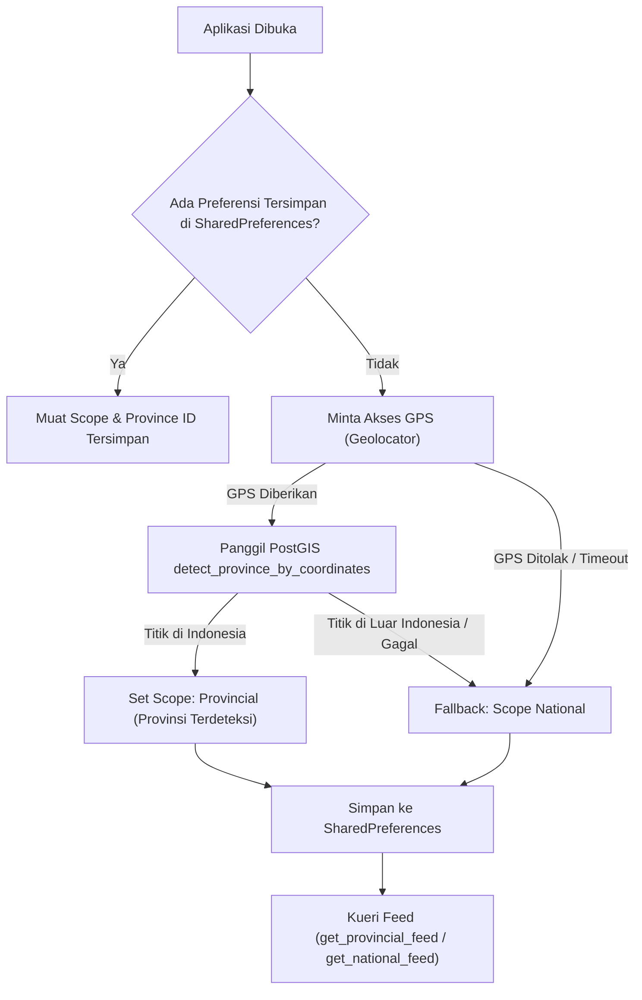

# Arsitektur Dual Feed & Seleksi Wilayah Laporin

Dokumen ini mendokumentasikan desain sistem Dual Feed (Nasional vs Provinsi), deteksi otomatis posisi pengguna via GPS, dan pengelolaan kueri feed skala besar.

---

## 1. Konsep Dual Feed

Aplikasi Laporin menyediakan dua mode penjelajahan laporan:

```
┌────────────────────────────────────────────────────────┐
│                   Dual Feed Context                    │
├──────────────────────────┬─────────────────────────────┤
│      Feed Nasional       │        Feed Provinsi        │
│    (Seluruh Indonesia)   │  (Berdasarkan 38 Provinsi)  │
├──────────────────────────┼─────────────────────────────┤
│ Menampilkan laporan dari │ Menampilkan laporan khusus  │
│ Sabang sampai Merauke    │ daerah yang dipilih / GPS   │
│ tanpa filter provinsi.   │ pengguna saat ini.          │
└──────────────────────────┴─────────────────────────────┘
```

Kedua mode ini tetap mematuhi secara ketat aturan invarian visibilitas publik:
```sql
publication_state = 'published'
AND handling_status NOT IN ('rejected', 'cancelled')
```

---

## 2. Alur Deteksi GPS & Penentuan Wilayah



---

## 3. Komponen UI Pemilih Wilayah

- **Lokasi**: Terdapat pada AppBar halaman Feed (`lib/features/feed/screens/feed_screen.dart`) dalam bentuk chip interaktif yang menampilkan nama wilayah aktif (misalnya: `"Seluruh Indonesia"` atau `"Jawa Tengah"`).
- **Modal Sheet (`ProvinceSelectorModal`)**:
  - Pilihan cepat `"Seluruh Indonesia"`.
  - Tombol aksi cepat `"Gunakan Lokasi Saat Ini (GPS)"` dengan spinner progress saat mendeteksi.
  - Daftar 38 Provinsi lengkap (dari Aceh hingga Papua Selatan) dilengkapi pencarian teks (search bar) responsif.
  - Indikator radio/centang pada provinsi yang sedang aktif.

---

## 4. Cursor-Based Pagination & Isolasi Context

Kueri feed dirancang untuk menangani jutaan baris data secara efisien tanpa pergeseran halaman (offset drift):

1. **Parameter Kueri**:
   - `p_cursor_created_at`: Timestamp laporan terakhir pada batch sebelumnya (descending).
   - `p_limit`: Ukuran batch (default 10 atau 20 laporan).
   - `p_category`: Filter kategori opsional.
   - `p_status`: Filter status opsional.
2. **Context Switching Clean Reset**:
   - Saat pengguna berpindah dari Feed Nasional ke Feed Provinsi (atau berganti provinsi), `FeedController` secara atomik mereset:
     - `_reports = []`
     - `_cursorCreatedAt = null`
     - `_hasMore = true`
   - Hal ini mencegah tercampurnya kartu laporan dari wilayah yang berbeda dalam satu scroll feed.
3. **Isolate Decoding**:
   - Penguraian JSON payload feed dari Supabase diproses di latar belakang menggunakan worker isolate (`Isolate.run` / `compute`) untuk mencegah frame-drop / UI jank pada perangkat low-end.

